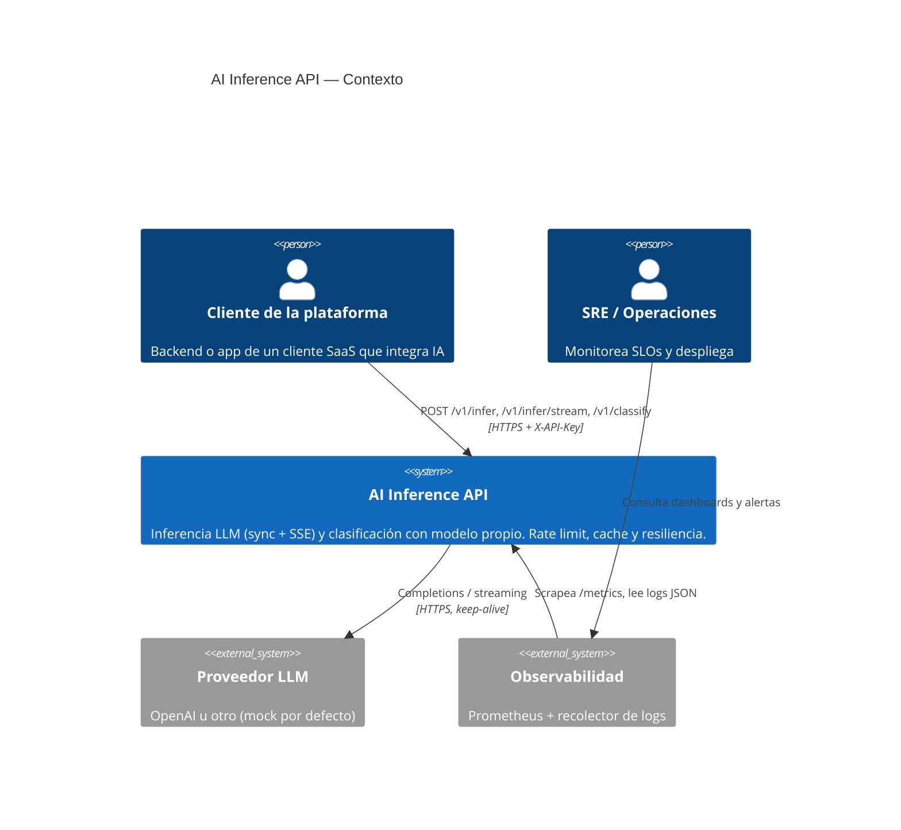
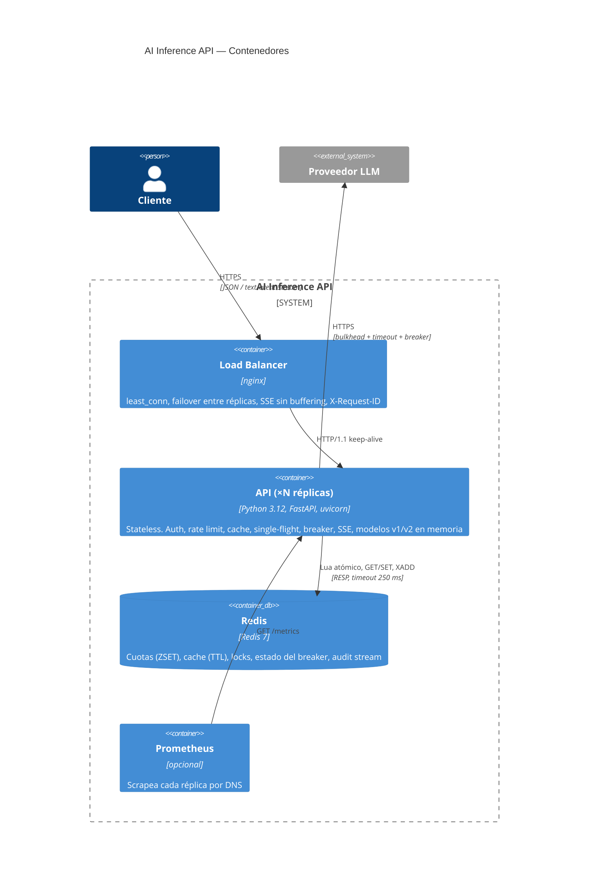
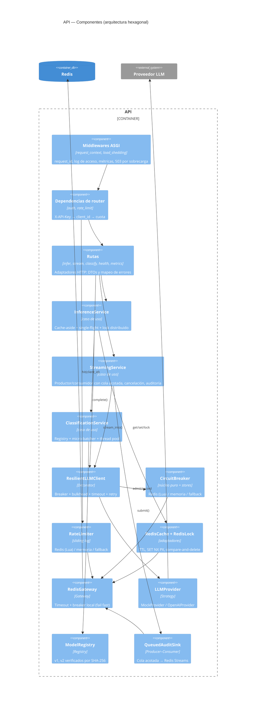
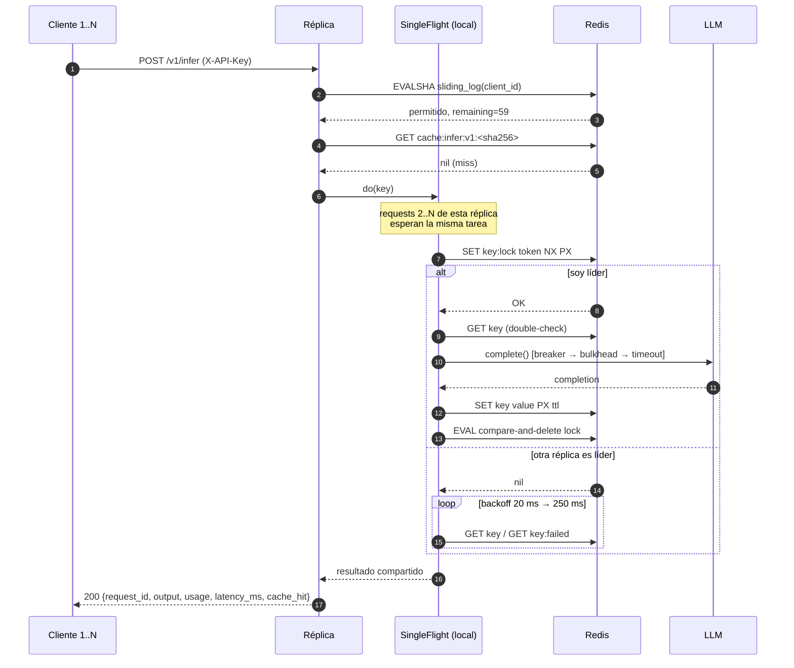
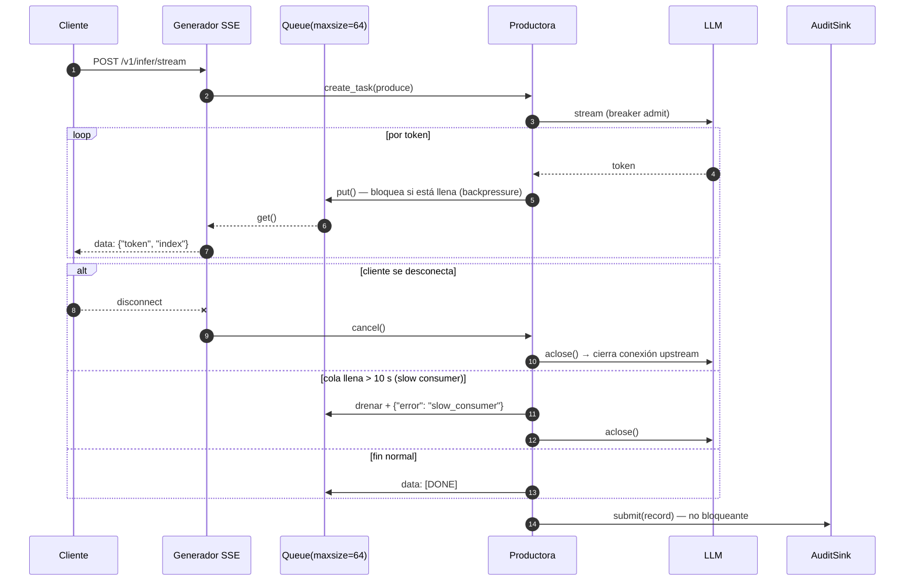
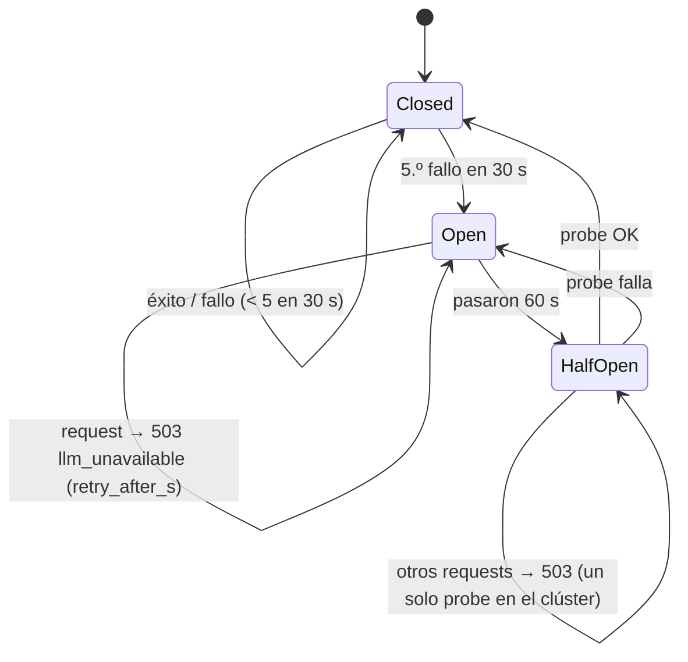
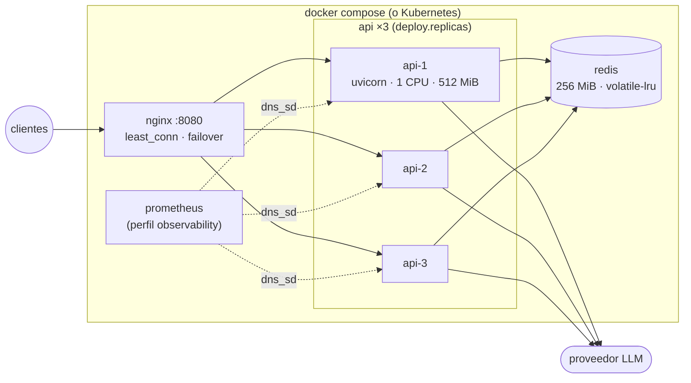

# Arquitectura — modelo C4

> Diagramas en Mermaid (GitHub los renderiza). La fuente equivalente en Structurizr DSL está en
> [`workspace.dsl`](workspace.dsl) (`docker run -p 8080:8080 -v $PWD:/usr/local/structurizr structurizr/lite`).

## Nivel 1 — Contexto

¿Quién usa el sistema y con qué sistemas externos habla?

## Nivel 2 — Contenedores

¿Qué unidades desplegables hay y cómo se comunican?

## Nivel 3 — Componentes (una réplica de la API)

## Diagramas dinámicos

### `POST /v1/infer` con thundering herd (Escenario A)

### `POST /v1/infer/stream` con backpressure y desconexión (Escenario C)

### Estados del circuit breaker (Escenario B)

## Despliegue

